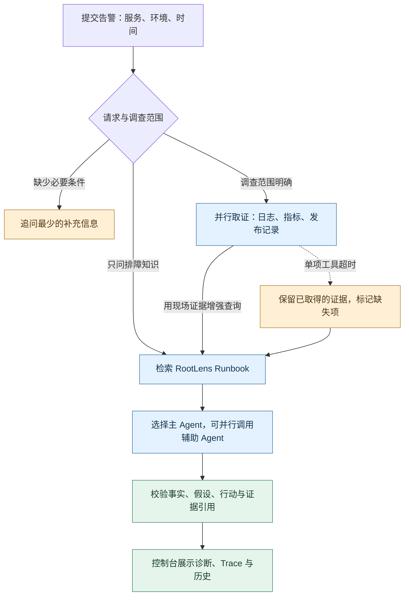

# RootLens · 多 Agent 故障诊断

给出一条服务异常描述，RootLens 会查询同一时间窗口内的模拟日志、指标和发布记录，结合 Runbook 给出**已确认事实、待验证假设、下一步行动**。每条诊断可以回看证据引用和执行轨迹。

[看交互演示（进入作品集后选择 RootLens）](https://young-recipe-72cc.gjh-cs24.workers.dev/) · [本地运行](#本地运行) · [架构与代码索引](docs/33-rootlens-architecture-walkthrough-cn.md)

## 一条告警怎么变成诊断

> **模拟告警** · payment-service 在 10:05 开始大量出现 5xx，之前刚发布 v2.3.7。



| 在控制台看什么 | 这个案例会展示什么 |
| --- | --- |
| **现场证据** | 10:00 的发布记录、10:05 起的 5xx 变化，以及连接获取超时日志。 |
| **主辅分析** | 应用 Agent 主诊断，数据库 Agent 根据连接池线索补充排查方向。 |
| **有边界的结论** | 发布时间相邻只支持「发布可能相关」。下一步需要对照版本与配置变化，检查连接生命周期和数据库侧指标。 |
| **工具失败时的表现** | 注入日志超时后，Trace 标记失败，结果保留已有证据，并指出当前判断缺了什么。 |

以上是基于合成数据的行为示例，具体回复随模型运行而变化。[五分钟演示和已有验收](docs/30-stage7-closeout-and-demo.md)

## 我实现的部分

| 工程问题 | 在 RootLens 中的实现 |
| --- | --- |
| **取证范围和来源** | 为日志、指标和发布记录建立统一的查询条件和证据契约。用现场证据增强 Runbook 检索，并把证据和通用排障知识分别传给诊断流程。 |
| **路由和诊断** | 将现场线索加入主辅 Agent 路由。使用 Pydantic 校验结构化诊断与证据引用，保留事实、假设和处置建议。 |
| **失败与回归** | 记录工具、检索与 Agent 执行状态及耗时。通过故障注入检查降级，评测入口复用诊断核心，用固定案例和独立预期验证结果。 |
| **界面与历史** | 用 React / TypeScript 展示证据、诊断和 Trace，使用 SQLite 保存历史。控制台支持解读已保存记录，也可以单独发起一次新诊断。 |

现有数据含 **4 组模拟事件**。仓库验收记录中，**6 个合成案例**通过结构化诊断检查，6 个案例均返回有效 Judge v2 结果。回归用于发现版本退步，适用范围是合成案例。系统未接入 staging 或生产数据。[六案例验收](docs/26-stage5-final-closure.md) · [执行轨迹与故障验收](docs/21-stage5-3-reliability-trace-acceptance.md) · [项目来源与贡献范围](docs/project-origin.md)

## 本地运行

需要 Docker Compose、Node.js/npm 和一个 Anthropic 兼容的模型接口。从仓库根目录运行。Windows 本地可将 npm 缓存放在 E 盘。

```powershell
Set-Location frontend
npm ci --cache E:\Codex\cache\npm
npm run build

Set-Location ../app
Copy-Item .env.example .env
```

如果已有 `app/.env`，跳过复制。打开 `app/.env` 填写模型配置并保留在本地，然后在 `app` 目录启动服务。

```powershell
docker compose up -d --build
docker compose ps
```

打开[诊断控制台](http://localhost:8081/console/)或 [API 文档](http://localhost:8081/docs)。输入上面的告警，事件时间用 **2026-09-01 10:05（北京时间）**。Nginx 使用 `frontend/dist`，改动前端后需要重新构建。历史访问与测试方式见[后端使用说明](app/README.md)。
