# RootLens 架构图与请求流程导读

本文先帮你把整个系统连起来，再去读[面试问答](32-rootlens-interview-qna-cn.md)。按当前源码整理，不把计划中的能力当成已经实现的能力。

**按“论文的总图 + 方法”来读：先在图中找到 M01 至 M09，再读同编号方法，最后才展开对应面试题。**编号表示一次请求的方法步骤，不是开发时的 Stage 1 至 Stage 7。每步都关注：输入、实现方式、输出、边界。

建议阅读路线：图 1 抓正常诊断主线 → 图 2 看请求分支 → M01 至 M09 看方法 → 图 3 看 Agent 如何协作 → 观察与验证部分。代码索引和阶段回顾放在后面，用于回查，不要求同时背下来。

先记住项目要解决的问题：**用户看到服务出错，但不知道该查哪里。RootLens 按服务和时间查询现场资料，查排障知识，组织不同专业方向的分析，再给出有依据、有边界的结论。**

主要面向需要初步排查和说明服务异常的技术支持、运维等人员；它提供诊断建议，不自动执行生产修复。

## 一、先认识六种信息

全篇只用 payment-service 这一个例子。它表示一个处理支付请求的应用服务，不是 RootLens 自己。

| 名称 | 回答的问题 | 例子 |
| --- | --- | --- |
| 用户描述 | 用户看到了什么？ | payment-service 从 10:05 开始大量报 500 |
| 现场资料 | 当时实际记录了什么？ | 错误日志、5xx 错误率、版本发布时间 |
| Evidence（现场证据） | 哪些资料经过查询范围与格式检查，可以交给本次诊断使用？ | 有来源编号、服务名、环境、时间的连接池错误日志 |
| Runbook（排障手册） | 遇到这类问题，应该如何检查和处理？ | 连接池耗尽时检查连接数、慢 SQL、连接释放情况 |
| IncidentDiagnosis（诊断结果） | 这次确认了什么、还怀疑什么、建议做什么？ | 确认连接获取失败；发布可能相关但尚未证实 |
| DiagnosisTrace（执行轨迹） | RootLens 为了得出结果，走了哪些步骤？ | 查询日志成功，Database Agent 成功，结构化校验成功 |

**资料有来源，不代表它能证明任意结论。**“发布发生在故障之前”只能证明时间顺序，不能单独证明“发布导致故障”。

## 二、正常诊断主线：先看这九步

**图 1 只画“信息充分的一次故障调查”的执行顺序。**每个框只向下一步连一条线，不穷举所有数据来源、存储读写和 Trace 记录关系。省略连线不代表省略能力；相关方法分别在后文展开。

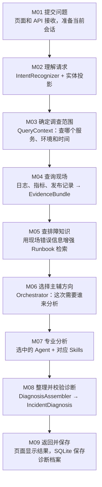

### 把图读成一件事

用户问：“payment-service 10:05 开始 5xx 激增，怎么回事？”

1. **先听懂并定范围**：调查哪个服务、哪个环境、什么时间附近。
2. **再查资料**：现场记录告诉我们出现了哪些现象；Runbook 告诉我们这类现象该怎么排查。
3. **最后分析并留下结果**：选择应用、数据库等合适角色分析，把事实、假设和建议分开，校验后展示和保存。

这就是完整主线。**Trace 是伴随过程的记录；Evaluation 和故障注入是单独运行的验证。**它们不需要各自向主线上的每个框画箭头，分别看第四至六节即可。

### 你以前的笔记，哪些保留、哪些修正

- **保留**：“QueryContext 是统一查询条件”，以及“Pipeline 决定安排什么、ToolManager 管调用边界、具体工具真正查数据”的三层分工。
- **修正 Pipeline 的位置**：它组织 M03 至 M08 的执行，不是 QueryContext 后又多走的一道工序。共享入口 `run_diagnosis` 先完成 M02，再进入 Pipeline。
- **修正路由分数的算法**：合入现场信号时是 `max(原分数, 证据下限)`，不是把两者直接相加。笔记里的 application 0.80 等数值只能作为示意，不能当成本次实际结果或根因概率。
- **更新版本**：旧笔记中的“未来的 Pipeline”和 dataset v1 是当时阶段记录；当前管线已经实现，演示运行数据为 `rootlens-demo:v2`。
- **修正评测的位置**：普通用户请求不是“回答之后自动进入 Evaluation”。Evaluator 是另外拿固定案例，复用诊断核心，再比较结果与标准。

缺服务或必要时间时，会在 M03 等位置走澄清；只问 Runbook 时跳过现场三工具。它们是图 2 的分支，不必挤进图 1。四种 Agent 的选择与协作在 M07 和图 3 展开。

| 图中位置 | 一句话方法 | 读完能回答的面试题 |
| --- | --- | --- |
| M01 | 接收问题，准备当前会话 | 第 4、28、29、45 题 |
| M02 | 分类调查目标，抽取并过滤实体 | 第 9、12、13、14 题 |
| M03 | 决定取证、知识问答或澄清，建立查询窗口 | 第 10、15、16 题 |
| M04 | 三工具并行查询，留下有来源的 Evidence | 第 16、18、19、20 题 |
| M05 | 用现场线索检索相关排障知识 | 第 21、22、23、24、25 题 |
| M06 | 根据领域信号选主辅，而非只按一个 Intent 硬分配 | 第 9、11、13 题 |
| M07 | 选中的专业角色并行分析，按角色注入 Skills | 第 6、7、8、26、27 题 |
| M08 | 将分析组织成可校验的结构化诊断 | 第 20、30、39 题 |
| M09 | 保存与回看，区分历史解释和重新诊断 | 第 28、38、42、45 题 |
| 观察/验证支线 | Trace、故障测试、Evaluation、Baseline | 第 31 至 37、40 题 |

题号对应[面试问题与口述答案](32-rootlens-interview-qna-cn.md)。这里把相关知识放回流程里理解，不把所有问答原文重复堆到图中。

读图时要注意四件事：

1. **Pipeline 是调度代码，不是一个额外的“大模型总指挥”。**它按既定顺序调用已有模块。
2. **Agent 是不同专业角色的模型调用，不是四台独立训练的模型。**当前可以共享同一模型接口，通过职责、上下文和 Skills 区分工作。
3. **现场工具和 RAG 查的不是同一份东西。**前者查“这次发生了什么”，后者查“这类问题怎么处理”。
4. **Trace 是伴随过程的记录，不是回答生成以后才补写的一段说明。**核心入口结束后，API 再尝试将它和结果一起存档。

模型调用分布在意图理解、查询改写/重排、专业 Agent、诊断组装等环节；可选 Judge 也调用模型。模型不是数据库，现场 JSON 查询、时间计算、路由合分、引用检查和数据库存取主要由普通代码完成。

当前部署用 Docker Compose 启动应用、Redis、ChromaDB、Nginx 和 Prometheus。浏览器入口为 `http://localhost:8081/console/`。图中现场数据仍是模拟数据，不能描述成已经接入公司的生产监控系统。

## 三、一次请求怎么走：不是每次都跑所有步骤

**图 2：主要分支流程。图 1 可以看作图 2 中“条件充分，正常调查故障”的那条路径的展开。**这张图补上“信息不足或只问知识时，哪些步骤不走”，但不穷举所有异常、重试和降级细节。图 1 回答“正常怎么走”，图 2 回答“什么情况换条路”，不用同时记两张图。

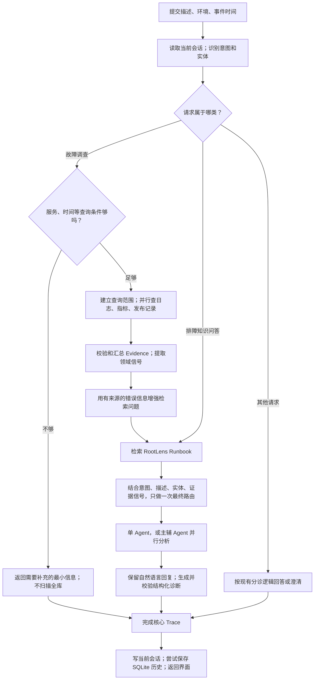

有些模糊请求也会在编排器中触发澄清；上图突出最常见的“查询条件不足”分支，不表示所有请求都只有这三种意图。

### 接下来怎样读每一步

**局部图只放大当前一步，不把总图的全部连线再搬过来。**每节先看输入、处理、输出，再看作用与技术、设计原因和案例。局部图中的小框是同一步的内部动作，不是新增的开发阶段。

九步始终沿用这份输入：

```text
问题：payment-service 从 10:05 开始 5xx 激增，刚发布 v2.3.7，帮我判断原因。
环境：demo
事件时间：2026-09-01 10:05，Asia/Shanghai
运行数据：rootlens-demo:v2
```

以下案例解释数据怎样交接，**不是一次新的真实模型运行报告**。Intent、检索命中、Agent 分工和回复示例用于说明目标行为，不保证每次模型调用的文字完全相同。

### M01 提交请求与准备当前会话

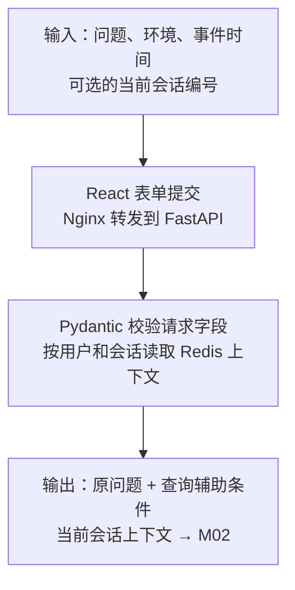

**输入**：用户描述、环境、事件时间，以及可选会话编号。**方法与技术**：React 收集表单，Nginx 转发，FastAPI 用 Pydantic 校验请求；API 按用户和会话读取 Redis，准备近期消息和摘要。**输出**：原问题、查询辅助条件、当前会话上下文，交给共享诊断入口；这一步还没有开始查支付服务的现场记录。

**作用与设计原因**：先把页面输入变成后端能处理的请求。React 管表单状态，Nginx 管入口转发，FastAPI 接收接口请求，Pydantic 管字段格式，Redis 提供当前会话的近期上下文。它们不是五种重复的“理解问题”工具。请求格式校验与后面的业务条件校验分开：格式正确，不代表一定已提供服务和故障时间。

**本例怎么走**：页面提交上述问题、`demo` 和带时区的事件时间；新会话可能没有历史，旧会话则可以带上近期上下文。交给 M02 的仍是用户原问题，不会因为读到历史摘要，就把摘要当成本次现场证据。

对应面试题：第 4、28、29、45 题。这里的 Memory 解释的是“用户刚才说了什么”，不是“公司系统当前发生了什么”。

| 输入 | 本例 | 用途 |
| --- | --- | --- |
| message | payment-service 从 10:05 开始 5xx 激增，刚发布 v2.3.7，帮我判断原因 | 理解调查目标、抽取服务名和线索 |
| environment | demo | 避免把不同环境的资料混在一起 |
| anchor_time | 2026-09-01 10:05，Asia/Shanghai | 确定要查哪个日期、哪个时间附近的记录 |
| conv_id | 当前对话编号 | 找到当前会话，不是服务名，也不是故障证据 |

`demo` 是演示数据环境，`staging` 通常指预发布环境，`prod` 指生产环境。**环境名称本身不会连接到某家公司系统**；要查询真实平台，需要另外实现对应数据适配器和权限。

### M02 理解问题：Intent 和 Entity

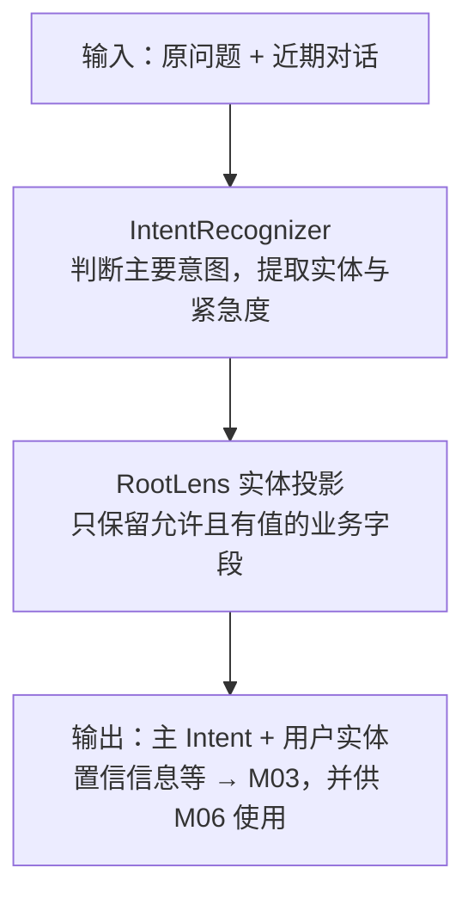

**输入**：原问题与有限的近期对话。**方法与技术**：`IntentRecognizer.recognize()` 识别主要意图，提取实体和紧急度；`project_rootlens_entities()` 过滤当前业务不允许的字段。**输出**：一个主 Intent、实体字典、置信信息等，交给 M03 和 M06。对应面试题：第 9、12、13、14 题。

**作用与设计原因**：将一句话拆成“要调查哪类问题”和“有哪些具体查询值”。自然语言理解可以用 LLM，强特征可由规则补充，但允许进入业务链的字段由程序明确限制。这样共享识别器即使返回旧客服实体，也不会让订单号、金额等字段污染 RootLens。保留单主意图，使后续接口清楚；需要多个专业方向时由 M06 决定，不把多 Agent 等同于多标签 Intent。

**本例怎么走**：用户明确把刚发布的版本和异常放在一起调查，目标分类是 `deployment_issue`；用户实体包含 `service_name=payment-service`、`start_time=10:05`、`version=v2.3.7`。此时用户还没有说 `DBConnectionError`，不能提前把它填成用户实体；后面工具查到再作为 Evidence 保存。

Intent 是“用户主要在调查什么”。本例把发布和异常联系起来，按当前 taxonomy 应归入 `deployment_issue`；如果只说服务 5xx 激增，通常是 `service_incident`。

Entity 是“描述中有哪些可用于查询的具体值”，例如 `service_name=payment-service`、`start_time=10:05`、`version=v2.3.7`。

共享识别器有 LLM、模板相似度和规则路径，但不是当前环境总开三路：配置了第三方兼容 `base_url` 时，代码关闭意图 embedding 路径，主要合并 LLM 与 Pattern；启用 embedding 路径但没有远程资源时，本地回退是字符 n-gram 哈希，不能包装成高质量语义模型。这与 M05 知识库向量检索是两回事。

实体由现有提取代码处理，不能说成全部由 LLM 生成；RootLens 随后投影业务白名单，防止订单号、金额等旧字段进入本次诊断上下文。当前允许的字段为 `date / service_name / start_time / version / status_code / error_code`，用户字段与后续证据提取字段分开保存。

**意图只有一个主要分类，不等于只能让一个 Agent 工作。**是否需要数据库方向协助，还可以由后面查到的证据决定。

### M03 判断路径与建立查询范围：Gate + QueryContext

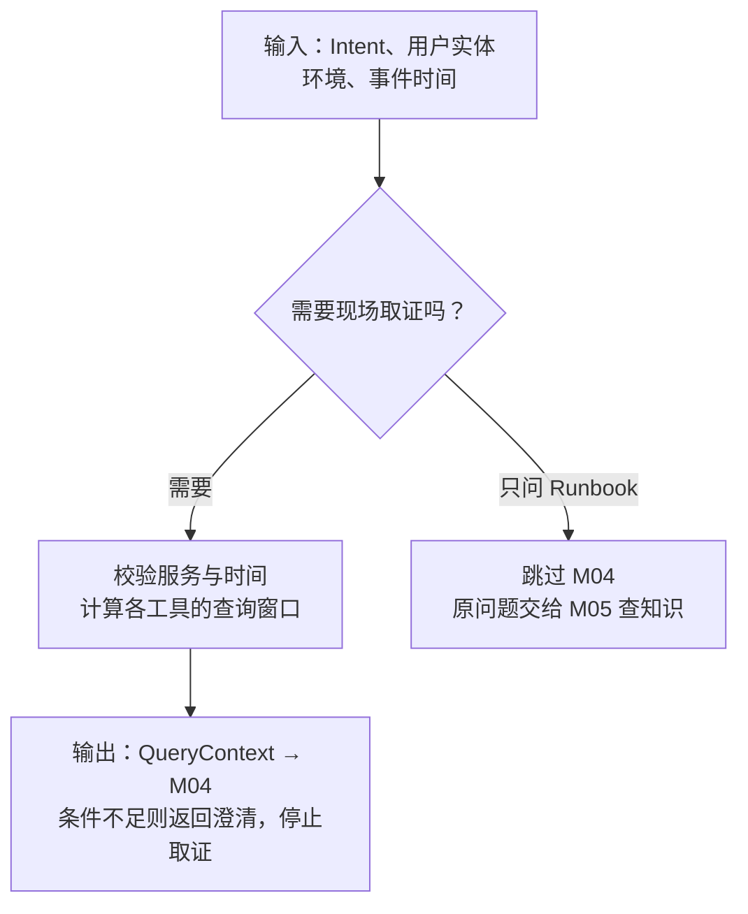

**输入**：Intent、用户实体、环境和事件时间。**方法与技术**：Pipeline 用代码判断该意图是否需要现场取证；需要时由 `build_query_context()` 和 `QueryContext.build()` 校验范围、计算窗口。**输出**：可执行的查询条件，或需要补充的最小信息。对应面试题：第 10、15、16 题。

**作用与设计原因**：给现场调查划边界，避免查错服务、查错日期或无条件扫描全部记录。Pydantic 定义条件结构，`datetime / ZoneInfo` 处理时间与时区，普通 Python 代码控制分支；不交给模型临时编查询范围。查询窗口统一计算，三个工具就不会各自猜不同的故障时间。

**本例怎么走**：针对 `payment-service / demo / 2026-09-01 10:05 +08:00`，日志和指标查 10:00 至 10:20，发布查 09:05 至 10:05。发布窗口向前回看，所以能找到 10:00 的版本变更。若连服务名都没有，就询问服务名，不会直接进入 M04。图中只展开故障与 Runbook 两种典型路径，其他意图仍按图 2 和实际 Gate 规则处理。

故障类请求一般取证，`runbook_query` 跳过现场三工具直接查知识。缺服务或无法确定必要时间时先追问，不把全部数据发给模型让它猜。

**这一处澄清通常是程序直接返回，不是 GeneralOpsAgent 先调用模型问一句。**编排器还有自己的低置信度澄清判断，同样不能一概说成“通用 Agent 负责所有追问”。

它就是“这次去哪里查、查哪个时间段”的结构化条件，不负责猜根因。

本例默认窗口：

| 工具 | 时间范围 | 为什么 |
| --- | --- | --- |
| query_logs | 10:00 至 10:20 | 看故障前后有哪些错误 |
| query_metrics | 10:00 至 10:20 | 看数值从正常到异常的变化 |
| query_deployments | 09:05 至 10:05 | 发布可能早于故障，必须向前回看 |

三个工具并行查询，但都必须按服务、环境、数据版本和时间过滤。查不到是 `empty`；执行异常是 `failed`；二者不能混为“没有故障”。

### M04 并行查现场，并整理为 Evidence

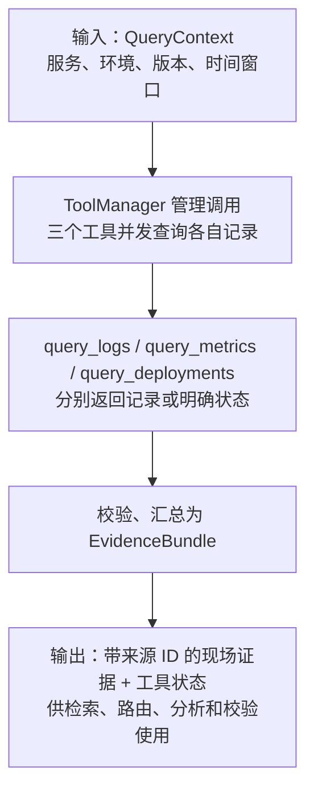

**输入**：M03 的服务、环境、数据版本与三个时间窗口。**方法与技术**：Pipeline 通过 ToolManager 调用三个注册工具，用 `asyncio.gather` 并发等待；工具筛选 JSON 模拟记录，`EvidenceBundle.from_results()` 再校验并汇总。**输出**：本次 Evidence 列表和每个工具的状态，分别送往 M05 的检索增强、M06 的领域信号和 M07 的分析上下文。对应面试题：第 16、18、19、20 题。

**作用与设计原因**：让系统拥有“实际查回来的材料”，而非只复述用户描述。三种查询不互相依赖，用 `asyncio.gather` 并发等待；JSON 适配器提供可复现的演示数据，Evidence 契约统一来源和状态，ToolManager 复用超时、缓存、熔断等边界。没有为每个工具另写一套治理逻辑，也没有让 Agent 自主决定无限次查询。

**本例怎么走**：日志返回连接获取失败和连接池耗尽；指标返回 5xx 上升及连接使用数达到上限；发布返回 10:00 部署 v2.3.7。每条材料保留自己的稳定 ID。若某个工具没有记录，记为 `empty`；若超时，记为失败或相应降级状态，不能把两者都解释成“没有异常”。

ToolManager 提供参数检查、缓存、超时、熔断和 fallback 的共享边界；不是每次都命中缓存，也不是工具失败后一定能恢复数据。Pipeline 负责安排调用，工具负责查资料，Agent 此时还没有执行。

#### 指标到底是什么

**指标是随时间记录的数值，用来衡量服务运行状态。**比如错误率、请求耗时、CPU 使用率、连接数量。

本例模拟数据确实包含：

| 指标 | 记录 | 表示什么 |
| --- | --- | --- |
| http_5xx_rate | 10:00 至 10:01 为 0.1%；10:05 至 10:06 为 28% | 请求中出现服务端错误的比例明显上升 |
| db_pool_in_use | 10:05 至 10:06 为 20 个连接，记录说明达到配置上限 | 连接池资源被占满，需要结合日志继续检查 |

对照来看：

```text
日志：10:05:12，一次连接获取失败，报 DBConnectionError / connection pool exhausted。
指标：10:05 至 10:06，5xx 错误率为 28%，连接使用数达到上限。
发布：10:00，部署了 v2.3.7。
```

日志讲具体事件，指标讲数值状态，发布记录讲系统变更。三者互补，但不能仅凭这几项判断究竟是连接泄漏、慢 SQL、流量突增还是配置问题。

#### Evidence：把查到的资料交给后续模块

工具结果经过格式和范围校验，形成 `EvidenceBundle`，包含每条记录的稳定 `evidence_id`、来源、服务、环境、发生时间、取回时间和各工具状态。

这使后续结论可以引用“本次查询实际返回的某条资料”，而不是一句无法回查的“据日志显示”。重复记录不会靠重复出现无限提高领域分数。

**来源可追溯不等于自动证明因果。**Evidence 校验能防止错误服务、时间范围或不存在的引用混入，不会自动证明模型对资料的每种解读都正确。

### M05 用现场线索检索 Runbook：Evidence-enhanced RAG

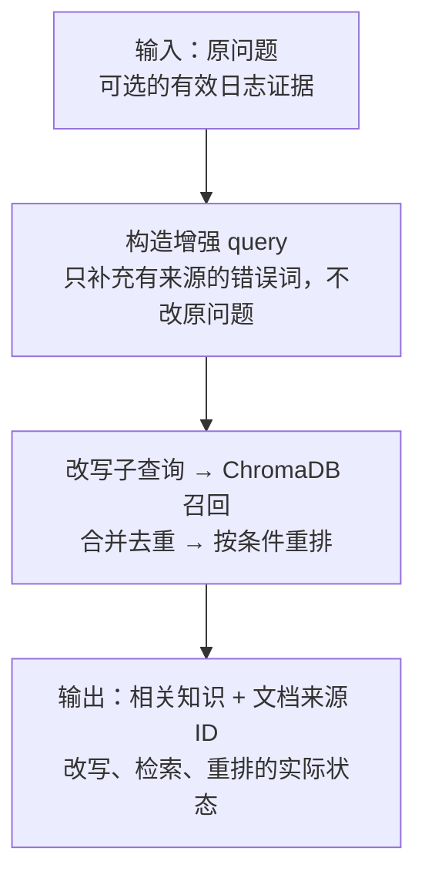

**输入**：用户原问题和可选的有效日志 Evidence。**方法与技术**：`build_retrieval_query()` 只补充有来源支持的错误词，ToolManager 负责改写、多 query 检索、去重和可选重排，KnowledgeBase 查询独立 ChromaDB collection。**输出**：相关知识文本、结构化来源 ID、各 RAG 阶段状态，供 M07 和 M08 使用。对应面试题：第 21 至 25 题。

**作用与设计原因**：现场资料说明现象，手册补充排查方法。ChromaDB 做知识向量检索，LLM 可做查询改写和候选重排；改写帮助从不同问法召回，重排帮助筛选候选，但都会增加成本，也可能失败，所以必须记录真实执行状态并保留回退路径。使用独立 collection 隔离客服知识，而不是靠 Prompt 要求模型忽略旧资料。

**本例怎么走**：原问题只提到 5xx 和发布；本次日志提供了 `DBConnectionError / connection pool exhausted`，这些有来源的词参与检索，使连接池手册更容易被找到。输出应能指出命中的文档和片段，不只是一句“参考了知识库”。若只问“连接池耗尽怎么排查”，也能直接检索手册，不要求先查现场。

图 1 中 M05 连到 M06，只表示先检索知识、再进入编排，**不是拿 Runbook 内容给数据库领域直接加分**。M06 仍使用 M02 的意图和用户实体，以及 M04 的现场领域信号；主线图不重复画这些跨步骤的数据传递。

Runbook 可以理解为**某类故障的排障操作手册**。当前连接池 Runbook 实际要求：

- 检查连接使用数、连接池上限、等待时间和活跃请求。
- 区分应用连接泄漏、慢 SQL、数据库不可达、流量激增。
- 比对异常前后的连接配置、查询耗时和流量。
- 不因连接池达到上限就认定数据库宕机，不自动扩大连接池或执行生产变更。

它告诉系统“接下来该怎么判断”，不是告诉系统“这次故障的标准答案是什么”。知识库也包含应用 5xx、发布排查手册和一条较早的历史事件。

本例检索过程：

```text
原问题：payment-service 从 10:05 开始 5xx 激增……
   + 本次日志里真实出现的 DBConnectionError / connection pool exhausted
   ↓
增强后的检索 query（不改用户原 message）
   ↓
LLM 生成不同角度子查询
   ↓
ChromaDB 召回候选片段
   ↓
合并去重；需要时由 LLM 重排；保留文档 ID / chunk ID / source_ref
   ↓
相关知识进入 Agent 上下文
```

增强词必须能回查有效日志来源，数量和长度受限；没有有效证据就回到原问题。RootLens 使用独立 collection `rootlens_runbooks_v1`，不自动导入旧客服种子数据。

改写、召回、重排分别记录 `performed / skipped / failed / degraded` 等实际状态，不保证每次都调用改写与重排模型。知识库不可用的提示文字也不算 Runbook 命中。当前还有额外无关命中，不能说检索已完全精准。

### M06 最终路由：这次让谁主分析、谁辅助

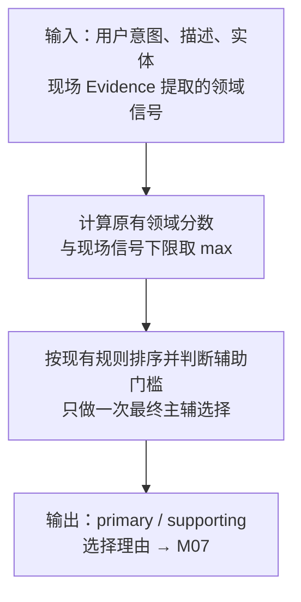

**输入**：用户 Intent、原描述、实体，以及 `extract_routing_signals()` 从 operational Evidence 提取的领域信号。**方法与技术**：Orchestrator 的 `_domain_scores()` 合分，`_route_decision()` 排序并应用辅助角色门槛。**输出**：`primary_agent / supporting_agents` 和选择理由，交给 M07。对应面试题：第 9、11、13 题。

**作用与设计原因**：决定“让谁分析”，而不是在这里直接宣布根因。普通 Python 评分和阈值规则让选择过程可检查、可重复；不额外请求模型自由挑角色，也不因为某条日志重复出现就无限累加分数。使用 `max` 让强现场信号给相关领域提供下限，同时保留已有用户线索；这是启发式设计，不是经过概率校准的统计模型。

**本例怎么走**：5xx 和近期发布提供应用方向线索，连接失败日志提供数据库方向线索，目标分工为 Application 主、Database 辅。即便 M02 只有一个 `deployment_issue`，也能让数据库角色参与。反过来，单纯检索到连接池手册，不应在没有现场依据时自动抬高数据库领域分数。

#### 把你笔记中 Evidence 的两种用途单独放大

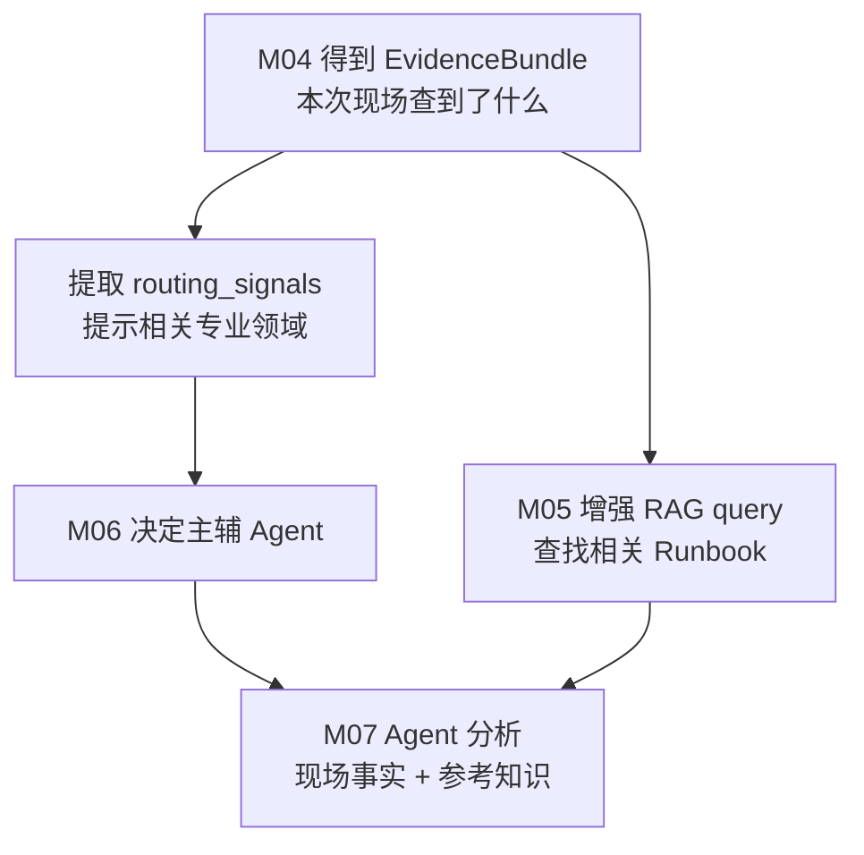

这两条线分别回答：**应该让谁来看？应该参考什么知识？**它们不是两次路由，也不表示两步一定并行执行；源码先提取领域信号，再检索知识，最后做一次主辅路由。

编排器结合用户意图、描述、实体，以及**现场证据**提供的领域信号评分。合入证据信号时用 `max(原分数, 证据信号下限)`，而不是把每条重复日志都累加。

本例的 5xx 支持应用方向，DBConnectionError 支持数据库方向，近期发布也是应用相关线索。目标行为是 Application 主分析、Database 辅助分析。Runbook 中出现的数据库词汇不能冒充现场数据库信号。

换个请求，如果主要是数据库慢查询，Database 可以做主 Agent；CPU 或节点问题可以由 Infrastructure 主分析。**主辅是本次分工，不是写死在 Agent 类上的等级。**领域分数是启发式路由依据，不是“数据库导致故障的概率”。

### M07 专业分析与 Skills：多个 Agent 怎么一起工作

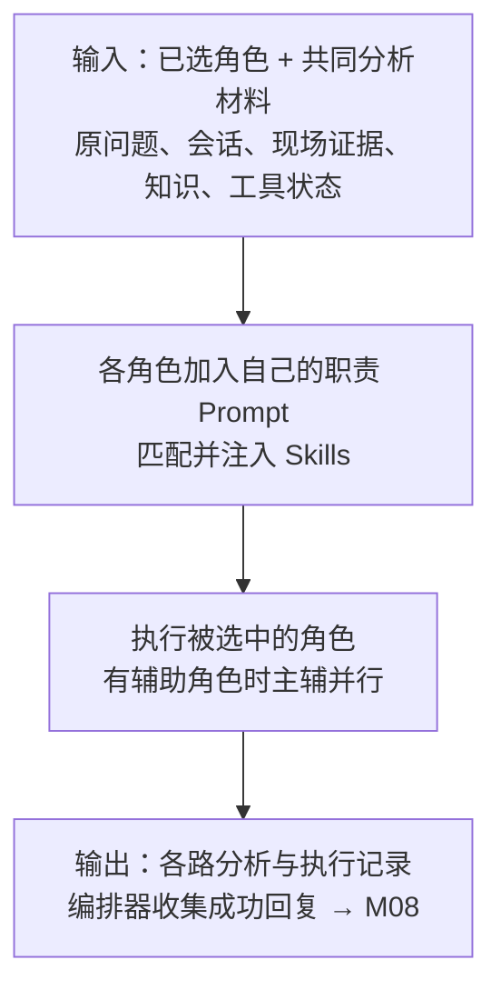

**输入**：M06 选出的角色，以及同一份用户问题、当前会话、RootLens 实体、现场 Evidence、Runbook 和工具状态。**方法与技术**：各角色继承 `BaseAgent`，按角色 Prompt 与匹配 Skills 构造上下文，通过模型 SDK 调用；有辅助角色时，`run_parallel()` 用 `asyncio.gather` 并发执行。**输出**：每路 `AgentResponse` 和执行记录，编排器收集成功回复，交给 M08。对应面试题：第 6、7、8、26、27 题。

**作用与设计原因**：让不同专业方向对同一份材料各有侧重地分析。角色 Prompt 定职责，Markdown Skills 放匹配的处理规则，`AsyncAnthropic` SDK 请求模型，`asyncio` 管并发；它们不是分别训练了多个模型。专业分工便于检查每路输出和失败状态，但多角色会增加模型调用成本，不能未经对照评测就声称一定优于单 Agent。

**本例怎么走**：Application 关注 5xx 的影响范围和发布前后变化；Database 关注连接池为何耗尽、下一步查连接释放还是慢 SQL。两者都能看到本次证据和手册，各自返回分析；它们不需要互相聊天，也不会因提出建议就直接修改数据库。

#### 四个角色：既看职责，也看实际调用位置

| Agent | 关注什么 | 在流程里何时出现 | 不要误讲成 |
| --- | --- | --- | --- |
| ApplicationAgent | 5xx、应用报错、接口异常、发布关联 | M06 选中应用方向后，在 M07 分析 | 它负责自己去调用全部现场工具 |
| DatabaseAgent | 连接池、慢查询、锁等待、数据库连接 | M06 选中数据库方向后，在 M07 主分析或辅助 | 它只配做辅助，或能直接操作数据库 |
| InfrastructureAgent | CPU、内存、磁盘、网络、节点、网关 | 有基础设施方向信号且被选中时，在 M07 分析 | 每次诊断都必须参与 |
| GeneralOpsAgent | 通用运维分诊、信息不足时的表达、证据缺口和部分失败兜底 | 通用路由或专业角色返回失败后的部分兜底路径 | 每次固定澄清、最终结构化汇总都必须由它调用模型完成 |

GeneralOps 的角色 Prompt 包含澄清和跨领域总结职责，但实际链路中：**M03/编排器可以直接用规则澄清；并行结果由编排器收集，统一结构化内容由 M08 组装。**角色职责描述不能代替执行调用链。

#### 图 3：把 M07 放大，跟着支付故障看并行协作

以下是当前支付示例的预期分工，不是新运行的实测结果。这个例子没有选中 Infrastructure 和 GeneralOps，所以不用把它们画成必经节点。

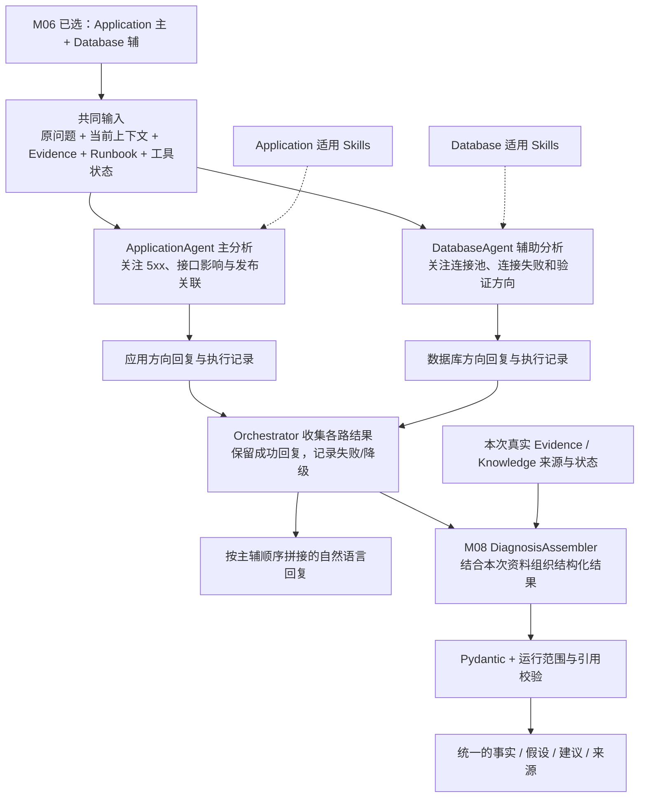

**图中没有 Application → Database 的箭头。**这表示它们同时分析共同材料，而不是先等应用结论，再让数据库 Agent 接着推理；也不是两者互相发消息或辩论。

例如，应用角色可以重点解释错误范围和发布时间线，数据库角色重点提出连接释放、慢查询和配置核查方向。角色分工是分析侧重点，不保证某个角色不会看到或提到其他领域。

对应第 6 题，“为什么不用一个 Agent”可以在这里理解：分工让分析重点、参与角色和各路失败状态更清楚；但增加角色也增加模型调用和成本。当前没有充分的单 Agent 对照实验，不能仅凭多 Agent 就宣称准确率更高。Assembler 能组织各路意见，不代表它已经证明矛盾意见中哪一个是真相。

#### Skills 在哪里生效：不是另一位 Agent

在真正调用角色模型前，`_build_system_prompt()` 将角色基础 Prompt、证据边界要求和匹配 Skills 拼起来。SkillManager 按适用 Agent 和关键词过滤，匹配文本也可包含证据提取的错误词，随后注入该角色的 system prompt。

```text
原问题 + 现场资料 + Runbook + 会话  →  大家共享的分析材料
角色 Prompt + 匹配 Skills         →  每个角色不同的职责与规则
```

因此，同一个模型接口也能被组织成应用、数据库等不同角色。当前差异主要在职责 Prompt 和适用 Skills，不能把它讲成各自独立训练了模型，或每个角色都有已验证的自主工具循环。

Skills 不替代 RAG：Runbook 讲“这种故障怎么查”，Skills 约束“这个角色按什么规范分析和表达”。Skills 也不直接执行修复命令。

#### 一个角色失败后，并行协作怎样继续

如果正常角色调用被封装为失败响应，现有 `_execute()` 可以尝试 GeneralOps 兜底，并留下“原请求角色 / 实际执行角色 / 是否降级”等记录。并行路径还能保留其他成功角色的结果；测试中直接抛出异常等分支要单独记录，不能一概声称一定成功兜底。

M08 可以把辅助意见缺失写入证据/分析缺口，不能把未完成的意见补写成成功分析。故障处理的具体边界见第五节。

### M08 输出：自然语言和结构化诊断并存

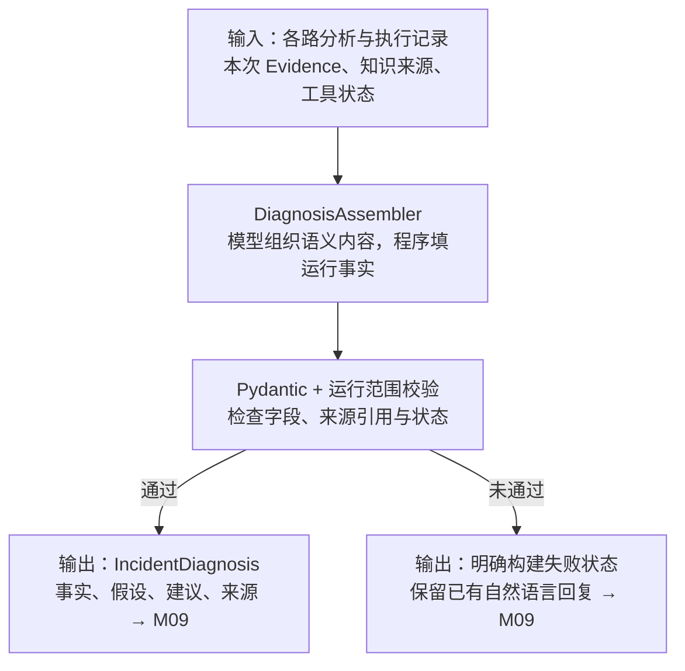

**输入**：M07 的各路执行记录与回复，外加真实 Evidence、Knowledge 来源及工具状态。**方法与技术**：Assembler 请求模型生成语义内容，程序填入运行事实，再通过 Pydantic 和 `validate_incident_diagnosis()` 校验。**输出**：`IncidentDiagnosis` 或明确的构建失败状态，与原有自然语言回复一起交给 M09。对应面试题：第 20、30、39 题。

**作用与设计原因**：把多段分析变成页面和接口能稳定消费的结果，并区分事实与假设。模型擅长组织语义，但本次实际路由、工具状态和来源不能任它编造，所以运行事实由程序提供，再做格式与引用检查。只返回 Markdown 很难稳定展示字段；只做 JSON 格式校验又拦不住引用不存在的证据，因此还需要运行范围校验。

**本例怎么走**：连接获取失败可以列为有日志支持的事实；连接泄漏、慢 SQL 等还需核查；10:00 发布是时间线索，不能直接升级为根因。结果附本次来源引用，前端按事实、假设、建议展示。若模型请求失败、JSON 无法解析或引用不合法，结构化部分失败，但不应伪造成功，也不随意丢掉 M07 已有回复。澄清分支可由程序直接生成结构，不要求再调用组装模型。

单 Agent 返回自然语言；主辅并行时，现有编排器先按主辅顺序拼接成功结果。**不要讲成这里还有一个独立的多 Agent 辩论或 ResponseComposer 模型。**

随后 `DiagnosisAssembler` 另行调用模型组织结构化内容，程序填入本次真实来源和状态，并校验：

- 格式和字段类型是否符合 Pydantic 契约。
- 引用是否属于本次真实取得的证据/知识。
- 实际路由和工具状态是否一致。
- 命中已定义高风险操作规则时，是否标注风险和审批要求。

希望本例表达成：

```text
已确认：服务有 5xx；日志记录连接获取失败；连接使用数达到上限。
待验证：是否存在连接泄漏、慢 SQL、流量或配置变更问题。
时间线索：10:00 发布先于 10:05 异常，尚不能证明发布是根因。
下一步：查连接释放、慢 SQL、流量与配置差异，必要变更先审批。
```

这是应检查的表达边界，不是每次模型输出的固定答案。Pydantic 和引用校验降低格式、越界引用风险，不证明诊断语义百分之百正确。若组装失败，返回明确构建状态，并保留已有自然语言回复，不伪造一个成功的结构化结果。

### M09 返回、保存与回看：把一次诊断变成档案

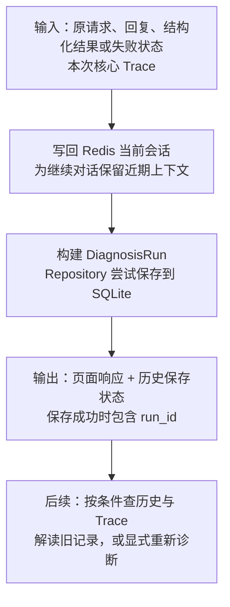

**输入**：原问题、当前会话 ID、自然语言回复、结构化结果/构建状态和已完成的核心 Trace。**方法与技术**：API 写回 Redis 当前会话，再调用 `build_diagnosis_run()`，通过 SQLAlchemy Repository 将这次诊断保存到 SQLite。**输出**：页面可展示的响应、`run_id` 和 `persistence_status`；后续可按服务、状态等筛选历史。对应面试题：第 28、38、42、45 题。

**作用与设计原因**：把一次即时回答变成可回看的诊断档案。Redis 解决当前对话连续性，SQLite 存长期档案，SQLAlchemy 管数据库映射和访问，Repository 封装保存、筛选与读取。SQLite 适合当前本地演示部署，不额外维护数据库服务；这不代表已证明其适合生产高并发。需要多人并发或独立数据库部署时，再评估 PostgreSQL 等方案。

**本例怎么走**：一次支付服务诊断保存为一个 `DiagnosisRun`，把原问题、回复、结构化结果和 Trace 关联在一起。历史列表能按 `payment-service` 找到它，详情能看当时怎样分析；“解读记录”解释旧结果，“重新诊断”才重新调查。历史落库失败则明确显示未保存，不应假装已有可查询档案；本节正常顺序也不代表 Redis 异常已经具备同样的降级保护。

前端分别展示事实、假设、建议、证据和工具状态，不必从一大段 Markdown 中猜字段。历史保存失败会明确标记，不能显示已保存；Redis 与历史保存的异常保护范围不同，见第五节。

完整边界在第四节展开：Redis 负责继续对话，ChromaDB 负责知识检索，SQLite 负责归档与历史查询。

## 四、Trace、历史、会话，不是三套重复存储

**对应 M02 至 M08 的过程记录和 M09 的归档；对应面试题：第 28、29、31、38、42 题。**Trace 伴随核心步骤记录执行，M09 再将它关联到历史；图 1 省略记录连线，它也不负责生成诊断意见。

### Trace 记录 RootLens 自己的过程

下面是示意，不是一次新运行的结果，也没有编造耗时：

```text
同一次诊断
  Intent                    success
  Evidence gate             acquire
  query_logs                success，关联日志 Evidence ID
  query_metrics             success，关联指标 Evidence ID
  query_deployments         success，关联发布 Evidence ID
  RAG stages                按实际执行记录成功、跳过或降级
  routing                   Application 主，Database 辅
  Application execution     success
  Database execution        success
  diagnosis assembly        success
```

真实 TraceStep 还可以包含开始/结束时间、耗时、错误码、缓存/降级标记等。耗时解释要看记录来源，不能把聚合观测值当作精确的每个底层调用耗时。

**payment-service 的错误日志**记录被调查服务发生的事；**RootLens Trace**记录诊断系统自身如何处理请求。Trace 不是模型隐含思维链，也不是全文 Prompt 或所有原始日志的录像。

当前 Trace 覆盖共享诊断入口内的核心步骤，不完整覆盖 HTTP、Redis 读写和 SQLite 存档，也不是 OpenTelemetry 全链路分布式追踪。

### 三种存储分工

| 存储 | 放什么 | 为什么不能互相替代 |
| --- | --- | --- |
| Redis | 当前会话最近消息和摘要 | 为继续对话提供近期上下文，不是最终诊断档案 |
| ChromaDB | Runbook/历史案例的可检索片段；保留独立记忆接口 | 为相似知识检索服务，不适合替代按时间和状态查历史的关系模型 |
| SQLite | DiagnosisRun：原问题、时间、自然语言回复、结构化诊断、Trace、来源引用等 | 为历史列表、筛选、详情和执行过程回看服务 |

RootLens 默认关闭用户画像读写和跨会话 episodic 自动召回，避免别人的旧故障混入当前现场。当前会话仍可使用 Redis；摘要失败保护是另一条已实现的记忆边界。

Trace **已经可以随 DiagnosisRun 保存到 SQLite**，由受访问令牌保护的 `/diagnoses/{run_id}/trace` 查询。历史接口令牌不是模型 API Key，也不是生产级多用户鉴权。

历史中“解读已有记录”只解释已存结论；“重新诊断”才重新进入 `/chat` 取证。它们不能混为“旧结论自动变成当前现场事实”。

## 五、故障降级测试：不是让系统自动修好故障

**这是验证 M04、M05、M07、M08 等失败行为的独立支线，对应面试题第 18、32、40 题。**不要把“故障注入控制器”接成图 1 中普通用户必经的业务节点。

**降级是某部分不可用时，保留仍可信的能力，明确说明少了什么，而不是假装全部成功。**

例如日志查询超时，系统仍可能拿到指标和发布记录，但不能再说“我从日志确认了 DBConnectionError”。是否继续分析、信息是否不足，都要由真实状态体现。

| 失败位置 | 当前处理思路 | 应观察什么 |
| --- | --- | --- |
| 单个现场工具失败 | 保留其他工具结果，标记 failed/degraded | 不把失败误写成 empty；不引用未取得的证据 |
| 查询改写或重排失败 | 可回退原 query 或原顺序，并记录实际状态 | 不能宣称改写/重排成功 |
| 知识检索失败 | 给出知识不可用边界，不把 fallback 说明当知识 | 不伪报 Runbook 命中 |
| 专业 Agent 返回失败 | 满足现有降级条件时尝试 GeneralOps；并行路径保留成功结果 | 标记实际执行者与失败/缺失意见；抛异常路径也要单独检查 |
| 组装 API、JSON 或引用校验失败 | 结构化构建失败，保留先前自然语言结果 | 不生成假的成功对象 |
| SQLite 保存失败 | API 尝试返回诊断，persistence_status=failed | 不能显示已保存，也不应丢弃已经形成的结论 |

测试用 `pytest`、`MonkeyPatch`、`AsyncMock` 等在受控边界制造超时、异常、空结果、坏 JSON、未知证据引用，再断言：

```text
故障确实进入真实处理分支
→ 输出符合约定的降级行为
→ Trace 记录正确
→ 没有虚构证据或成功状态
→ 测试退出后替换恢复，其他案例不被污染
```

故障注入位于 `test_support/failure_controller.py`，普通 `/chat` 没有公开的故障注入开关。它验证的是 RootLens 的部分失败处理，不是对真实生产系统做破坏，也不意味着已经完成所有 Redis/Chroma/provider 宕机研究。

特别注意：当前 `/chat` 的 Redis 读取、写入不能简单等同于“历史保存失败不阻断返回”；不能把 SQLite 的保护范围扩写成所有依赖都自动容错。同一 provider 故障时，换 Agent 角色也未必能恢复调用。

## 六、自动化评测：固定题目，检查系统有没有退步

**这是重复运行 M02 至 M08 并检查结果的评测支线，对应面试题第 33 至 37 题。**核心流程复用，不代表每次 `/chat` 都会调用 Judge 自我打分。

这里要区分两类东西：**pytest 测代码行为；Evaluation 测整条诊断链的输出质量。**两者可以结合，但不是同一个指标。

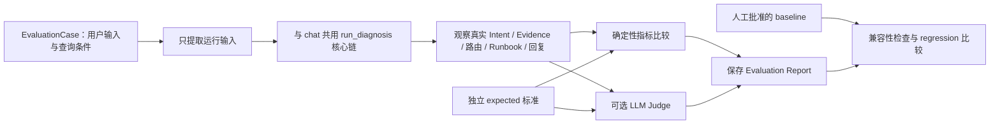

expected 只在诊断完成后供比较和评分使用，不能流入现场工具、RAG、Agent 或会话。Judge 可以看到评分标准，但它属于评测方，不是负责诊断的 Agent。

| 检查 | 例子 | 检查方式 |
| --- | --- | --- |
| Intent | 聚焦发布关联的请求是否归入 deployment_issue | 与 expected intent 比较 |
| 主辅 Agent | 数据库证据是否触发 Database 辅助 | 比较实际结构化路由 |
| Evidence | 必须找到的日志/指标是否返回 | 比较稳定来源 ID 或类型 |
| Tool 状态 | 缺发布数据是否为 empty，而非失败 | 比较工具状态 |
| Runbook | 是否命中连接池手册 | 比较文档 ID，不解析回答猜测 |
| 澄清 | 缺少必要信息时是否停止盲查 | 比较 clarification 状态 |
| 结构化结果 | 格式、引用和运行来源是否合规 | 结构化观察和校验 |
| 回答质量 | 证据是否支撑推理，建议是否可执行、是否承认不确定性 | 可选 Judge 四维评分，再人工复核 |

Judge 的四维是证据支撑、诊断推理、可执行性、安全与不确定性；评分失败不填默认有效分。Baseline 是人工批准的一份旧结果，后续版本在 suite、dataset、schema 等兼容条件下与之比较；新报告不会自动获批。

当前正式 suite 是 **stage3-v3 / rootlens-demo:v2 的六个合成案例**。它能检验已定义场景是否退步，不能证明真实公司故障的总体准确率。评测复用诊断核心，不等于完整覆盖普通 `/chat` 的 Redis 会话和历史存档生命周期。

### 别混淆三种“指标”

- **现场指标**：payment-service 的 5xx、CPU、连接数，用来排查被调查服务。
- **系统监控指标**：RootLens 自己调用耗时、成功率等，Monitor/Prometheus 用来观察自身健康。
- **评测指标**：固定案例上的 Intent Accuracy、Macro-F1、Evidence coverage 等，用来检查版本效果。

## 七、技术与代码对应表

先按职责记，再去读文件，不要求一次背下所有名字。

| 图中位置 / 职责 | 当前主要技术 | 主要代码 | 为什么放在这里 |
| --- | --- | --- | --- |
| M01、M09 页面交互 | React、TypeScript、React Router、Vite | `frontend/src/` | 管理提交、澄清、结果展示和历史页面状态 |
| M01、M09 页面/接口入口 | Nginx、FastAPI、Pydantic | `app/config/nginx/nginx.conf`、`app/api/main.py` | 转发请求，校验请求和响应，提供 API |
| M02 理解问题 | LLM、规则、模板相似度；实体白名单 | `app/core/intent_recognizer.py`、`app/core/rootlens_config.py` | 识别主要调查焦点与业务字段 |
| M02 至 M08 共用核心入口 | Python async、ContextVar | `app/core/diagnosis_entry.py` | chat/eval 复用识别与管线，隔离当前 Trace |
| M03 至 M08 顺序编排 | Python 显式 Pipeline | `app/core/diagnosis_pipeline.py` | 负责分支和调用顺序，不复制各模块实现 |
| M03、M04 查询条件/证据 | Pydantic、datetime、ZoneInfo | `app/core/evidence.py` | 把服务、环境、时区、窗口与来源约束明确化 |
| M04 现场工具 | JSON 数据适配、asyncio.gather | `app/mcp/incident_tools.py` | 可复现地查三种现场资料；尚非生产监控接入 |
| M04、M05 工具治理 | 超时、TTL 缓存、熔断、fallback | `app/mcp/tool_manager.py` | 为注册工具提供共用调用边界；不是所有缓存都放 Redis |
| M05 知识检索 | ChromaDB、向量检索、LLM 改写与重排 | `app/mcp/knowledge_base.py`、`app/mcp/tool_manager.py`、`app/core/rag_query.py` | 在手册中找相关知识，不用模型凭空记忆答案 |
| M06、M07 证据增强路由/执行 | 确定性信号规则、主辅评分、asyncio 并行 | `app/core/routing_signals.py`、`app/agents/agent_orchestrator.py` | 现场证据能影响专业分工，不依赖多标签 Intent |
| M07 业务处理规则 | Markdown Skills、Agent/关键词过滤 | `app/core/skill_loader.py`、`app/skills/` | 将可维护的处理要求注入匹配角色 |
| M02、M05、M07、M08 等模型调用 | AsyncAnthropic SDK、兼容 provider API | 各模块模型调用处 | 调远程模型，不是本机训练模型；SDK 不等于模型厂商 |
| M08 结构化诊断 | JSON、Pydantic、运行范围校验 | `app/core/diagnosis_assembler.py`、`app/core/incident_diagnosis.py`、`app/core/diagnosis_validation.py` | 使结果可被页面消费，并限制来源引用与状态 |
| M01、M09 会话记忆 | Redis、摘要；独立 Chroma 记忆接口 | `app/memory/conversation_memory.py` | 保留当前对话；RootLens 默认关闭画像和跨会话自动召回 |
| 观察支线 执行轨迹 | 自定义 TraceRecorder、ContextVar | `app/core/diagnosis_trace.py` | 关联每次诊断的核心执行状态，不引入完整分布式追踪平台 |
| M09 历史档案 | SQLite、SQLAlchemy、Repository | `app/persistence/` | 按服务/状态/时间查询记录，保存结构化结果与 Trace |
| 评测支线 | 确定性评分、LLM Judge、baseline 比较 | `app/evaluation/rootlens_*.py` | 检查诊断行为与输出质量，不另造一套业务链 |
| 测试支线 故障测试 | pytest、pytest-asyncio、MonkeyPatch、AsyncMock | `app/test_support/`、`app/test_rootlens_*.py` | 可重复制造部分失败并检查隔离、降级和 Trace |
| 测试支线 前端测试 | Vitest、React Testing Library | `frontend/` 测试文件 | 验证提交、筛选、追问等界面行为 |
| 部署与监控底座 | Docker Compose、Monitor、Prometheus | `app/docker-compose.yml`、`app/monitor/` | 组装本地服务，观察 RootLens 自身运行 |

目前主链是显式代码编排，没有必要讲成 LangGraph/CrewAI 工作流；知识检索也不能说成已实现 BM25 混合检索。ChromaDB 知识向量与意图识别的 n-gram fallback 是两条不同路径，不要混讲。

## 八、每个开发阶段补了哪一块

| 阶段 | 通俗理解 | 对应架构位置 |
| --- | --- | --- |
| Stage 1 | 让系统听懂故障描述，选对专业方向 | Intent、Entity、主辅 Agent、Skills |
| Stage 2 | 让系统自己查资料，而非只听用户说 | QueryContext、三个现场工具、Evidence、独立 RAG、证据增强路由、记忆隔离 |
| Stage 3 | 让评测和实际诊断用同一条核心链 | EvaluationCase、确定性指标、Judge、Baseline/Regression |
| Stage 4 | 让结果不只是长文本 | IncidentDiagnosis、Assembler、Pydantic 和运行来源校验 |
| Stage 5 | 让执行过程可查，部分失败可验证 | Trace、受控故障注入、Reliability 测试与真实验收 |
| Stage 6 | 让诊断结束后仍能找回来 | DiagnosisRun、SQLite Repository、受保护的历史/Trace API |
| Stage 7 | 让人能操作和查看这些能力 | React 工作台、补充信息、结果/历史/Trace 页面、历史解读与重新诊断 |

这是职责回顾，不代替各阶段验收状态；最新验收与剩余确认项以 [progress](03-progress.md) 和 [closeout](30-stage7-closeout-and-demo.md) 为准。

## 九、出现问题，沿着哪一层查

| 用户看到的问题 | 优先看哪里 | 需要排除的误判 |
| --- | --- | --- |
| 总让补充服务或时间 | 前端实际请求、实体投影、QueryContext gate | 不一定是知识库太小，可能根本没进入检索 |
| 查询结果为空 | service/environment/date/window、Tool status | 不把 empty 当“服务健康”，也不先改 Prompt |
| 没选 Database 辅助 | 实际日志 Evidence、routing signal 来源、领域评分 | Runbook 命中数据库不应自动等于现场数据库故障 |
| Runbook 不相关 | 增强 query、召回文档 ID、rewrite/rerank 状态 | 不是只看回答里有没有提到手册名称 |
| 把发布认定为根因 | Agent 回复、Assembler 输出、引用与人工审查 | 引用合法不等于因果推理正确 |
| 结构化区块没出现 | diagnosis_status、Assembler Trace、JSON/引用校验错误 | 不能只根据自然语言回复判断结构化成功 |
| 历史进不去 | history 启用状态、历史令牌、HTTP 状态、Repository | 历史令牌不是模型 Key；不一定是诊断失败 |
| 历史已存但缺新证据 | 当前操作是“解读”还是“重新诊断” | 历史解读不会重新取证 |

## 十、你现在怎么讲，比背整段更容易

先像读论文方法图一样，按图 1 编号复述一遍，再展开图 3。可以用下面这张“同一案例的中间结果表”检验自己是否真正接上了每一步；它描述预期数据交接，不是又一次真实验收报告。

| 步骤 | 拿到什么 | 交给下一步什么 |
| --- | --- | --- |
| M01 | 用户描述 payment-service 发布后 5xx，demo，2026-09-01 10:05 | 原 message、环境、带时区时间和当前对话上下文 |
| M02 | 上述描述与近期对话 | 主意图 deployment_issue；服务、时间、版本等用户实体 |
| M03 | 意图与查询条件 | 现场三工具的服务/环境/时间范围 |
| M04 | 范围内模拟记录 | 5xx、连接失败、连接数、发布记录等 Evidence，以及工具状态 |
| M05 | 原问题 + 有来源的连接错误词 | 相关 Runbook 片段、稳定文档来源、检索阶段状态 |
| M06 | 用户领域线索 + 现场领域信号 | Application 主、Database 辅的路由决定 |
| M07 | 同一份资料 + 各自角色规则 | 两个方向各自的分析与执行记录；不是相互聊天后的共同回答 |
| M08 | 各路分析 + 本次真实来源与状态 | 事实、待验证假设、建议和来源构成的合法结构化对象，或失败状态 |
| M09 | 本次请求、回复、结构化结果、Trace | 页面响应与历史档案；之后能回查，不等于自动取到新现场资料 |

能讲通这张表，就能把“Agent 是什么”“RAG 做什么”“为什么还要结构化输出”等问题放回同一条主线上，而不是各背一段定义。

先按五个动词讲，再展开被追问的部分：

> **理解 → 查现场 → 查手册 → 分工分析 → 校验并保存。**

口述可以这样开始：

> 我做的是 RootLens，给技术支持和运维人员辅助排查服务异常。比如支付服务突然大量报 500，系统先确认服务和故障时间，再查这个时间附近的日志、错误率和发布记录。日志可能告诉我们连接获取失败，指标告诉我们错误率和连接数有没有异常，排障手册则告诉我们下一步该检查什么。之后由应用和数据库方向的 Agent 分工分析，把已经查到的事实、还没证实的原因、建议动作分开呈现。执行过程会记录下来，结果也能保存到历史，方便回看和继续解释。

对方问“怎么保证不是胡说”，再讲来源 ID、结构化校验、失败状态和独立评测。问“怎么定位慢或失败”，再展开 Trace。**不要在开场把所有模块名和技术名一次念完。**

学习时先能回答四个问题：这一步拿到什么输入？产出什么？为什么下一步需要它？失败时怎么表现？答得出来，架构才真正连起来了。
